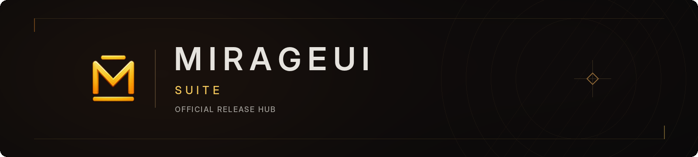
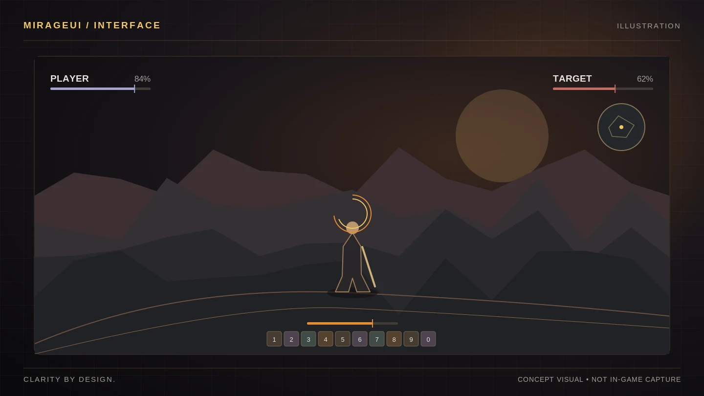
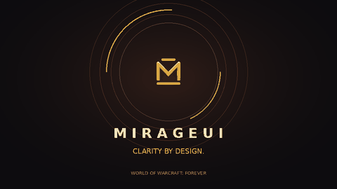

  
  <h1>Clarity by design.</h1>
  
A refined interface suite for <strong>World of Warcraft: Forever</strong>.

  

    
  

  
<strong><a href="https://apps.microsoft.com/detail/9P9K6ZRQHZJR">Microsoft Store</a></strong> &nbsp;·&nbsp; <a href="https://github.com/ragadio15/MirageUI-Releases/releases">GitHub downloads &amp; release notes</a>

  
Forever only · Windows installer

  
<strong><a href="https://ragadio15.github.io/MirageUI-Releases/">Explore the MirageUI website</a></strong> — interactive suite showcase, motion studies, installation guide, and release information.

  
<a href="#installation">Installation</a> &nbsp;·&nbsp; <a href="#the-suite">The suite</a> &nbsp;·&nbsp; <a href="https://github.com/ragadio15/MirageUI-Releases/issues">Support</a>

---

## Installation

1. **Get the installer.** Open the [MirageUI Installer on the Microsoft Store](https://apps.microsoft.com/detail/9P9K6ZRQHZJR) and install it on Windows.
2. **Set up.** Fully exit WoW, open MirageUI Installer, and confirm your World of Warcraft: Forever installation folder.
3. **Install or update MirageUI.** Check for updates in the installer, select an available Suite release, and install it.

**Prefer GitHub?** Visit [Releases](https://github.com/ragadio15/MirageUI-Releases/releases) for the portable Windows x64 installer (`MirageUIInstaller.exe`), Suite ZIP archives, and release notes. For a local archive, use **Choose ZIP** in the installer.

The Store listing distributes the installer; the MirageUI Suite itself is distributed through GitHub releases.

### Release channels

**Stable** — standard releases intended for regular use.  
**Pre-release** — optional test builds; bugs may occur. If only pre-releases are listed, no stable Suite build is currently published. To test, enable **Settings → Include test versions** in the installer, if available in your installed version.

## The suite

  
  
Original feature illustration · not an in-game capture

**Interface** — MirageUI and MirageUI Options.  
A cohesive, customizable gameplay interface.

**Companions** — Cursor Companion, Sanctuary, and Wealthcraft.  
Focused tools for moment-to-moment gameplay, preparation, and the economy.

**MirageIntel** — Core, Map, Navigate, Gather, and Insight.  
Integrated exploration, navigation, and information utilities.

Play the MirageUI brand animation

[Explore all six suite areas and motion studies](https://ragadio15.github.io/MirageUI-Releases/#experience). Feature studies are illustrations; actual capabilities and behavior depend on the installed release.

## Support & compatibility

MirageUI is designed for **World of Warcraft: Forever**, not Retail or Classic. Fully exit the game before updating. The installer is designed to back up earlier MirageUI addon folders and leave unrelated addons and WoW SavedVariables untouched. Back up your in-game settings before testing pre-releases; check the release notes and available SHA-256 checksums.

[Report an issue or request a feature](https://github.com/ragadio15/MirageUI-Releases/issues) — include your installer and Suite versions, game client build, and a brief description of what happened.

Microsoft Store product identity

| Field | Value |
| --- | --- |
| Publisher display name | MirageUI |
| Store ID | `9P9K6ZRQHZJR` |
| Package identity name | `MirageUI.MirageUIInstaller` |
| Package family name (PFN) | `MirageUI.MirageUIInstaller_2annypq7pfkw6` |
| Web Store listing | [MirageUI Installer](https://apps.microsoft.com/detail/9P9K6ZRQHZJR) |
| Windows Store deep link (copy URI) | `ms-windows-store://pdp/?productid=9P9K6ZRQHZJR` |

---

  
  
MirageUI · Independent community UI project Not affiliated with Blizzard Entertainment.

  
Official public distribution repository. Source development is maintained separately.

